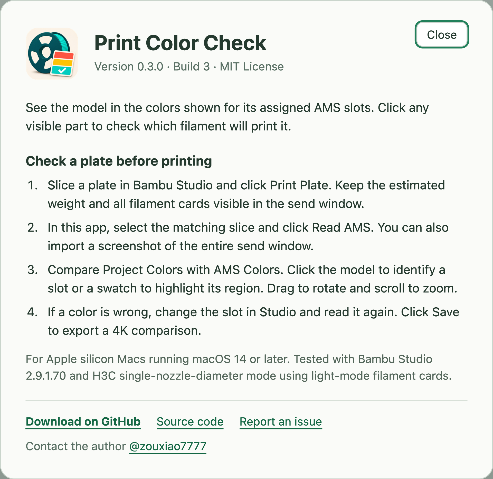

[简体中文](README.md) | English

<p align="center"></p>

# BambuPrintColorCheck · Print Color Check

A standalone Mac companion for Bambu Studio. It reads the selected plate’s sliced toolpaths and the filament cards in the Send Print Job window, then renders a rotatable 3D view using the assigned AMS slot colors. Zoom in to see which filament will print a particular detail before you send the job.

[Download the Mac beta](https://github.com/zouxiao7777/BambuPrintColorCheck/releases) · [Installation guide](Docs/INSTALL-English.txt) · [Report an issue](https://github.com/zouxiao7777/BambuPrintColorCheck/issues) · [Contact @zouxiao7777](https://github.com/zouxiao7777)

## When it helps

Suppose you painted a panda’s tongue pink, then assigned that filament to a slot holding black filament. The project preview still shows pink. Switch to AMS Colors and zoom in on the mouth to see the tongue rendered in the slot color. If several project filaments share one slot, click each swatch to highlight the region it controls.

## Install and check a plate

1. Download the macOS arm64 ZIP from Releases. Extract it and drag `BambuPrintColorCheck.app` to Applications. The app supports English and Simplified Chinese and remembers your selection.
2. Slice a plate in Bambu Studio and click Print Plate. Keep the estimated weight and all filament cards visible in the send window. Select the matching project and slice in the helper.
3. Click **Read AMS**. With macOS Screen Recording access, the helper reads the selected Studio process’s print window and rechecks it about every four seconds while it is open. You can also import a screenshot of the entire window. Read or import again after changing a slot.
4. Switch between **Project Colors** and **AMS Colors** with the same camera angle. Click the model to identify its filament and slot. Click a swatch to highlight the exterior it prints, then click the label at the top left to zoom there. Drag to rotate, scroll or pinch to zoom, and Shift-drag to pan.
5. Correct a mismatch in Studio and verify it before sending. Save a 4K side-by-side comparison or an AMS-only image. Open **About** in the toolbar or the macOS application menu for instructions, version information, downloads, and contact details.



## Compatibility and color interpretation

- Requires an Apple silicon Mac running macOS 14 or later. Tested on macOS 26.5 with Bambu Studio 2.9.1.70 and H3C single-nozzle-diameter mode using light-mode filament cards. Other layouts have not been validated.
- Opens active Studio slice caches, Bambu-annotated `.gcode`, and sliced `.gcode.3mf` files. If a regular `.3mf` contains only a model or plate thumbnail, slice it in Studio to inspect the 3D result.
- The reader checks card order, project colors, slot labels, and estimated weight when available. The view shows exterior toolpaths in the solid colors registered for the slots. Check the physical spools separately for loading, transparency, gradients, and finish.
- This independent, unofficial beta is ad-hoc signed. It does not carry a Developer ID signature or Apple notarization.

## Build from source

Install Xcode Command Line Tools on an Apple silicon Mac. With a macOS 14 or later SDK that includes the ScreenCaptureKit screenshot API, run:

```sh
./build.sh
open BambuPrintColorCheck.app
```

To export a comparison from a saved slice and a print window screenshot:

```sh
./BambuPrintColorCheck.app/Contents/MacOS/PlatePreview \
  --project "/path/to/plate.gcode.3mf" \
  --snapshot "/path/to/send-window.png" \
  --export "/path/to/color-check.png"
```

Use `--highlight 4` to frame project filament 4 or `--actual-only` for a single AMS-colored image. Choose a new output filename. Run `./Scripts/package.sh` to build release assets under `dist/`.

Released under the [MIT License](LICENSE). Studio format references are available in the upstream [send dialog](https://github.com/bambulab/BambuStudio/blob/v02.09.01.70/src/slic3r/GUI/SelectMachine.cpp), [filament cards](https://github.com/bambulab/BambuStudio/blob/v02.09.01.70/src/slic3r/GUI/MaterialItemHotend.cpp), and [slice cache](https://github.com/bambulab/BambuStudio/blob/v02.09.01.70/src/slic3r/GUI/PartPlate.cpp).
