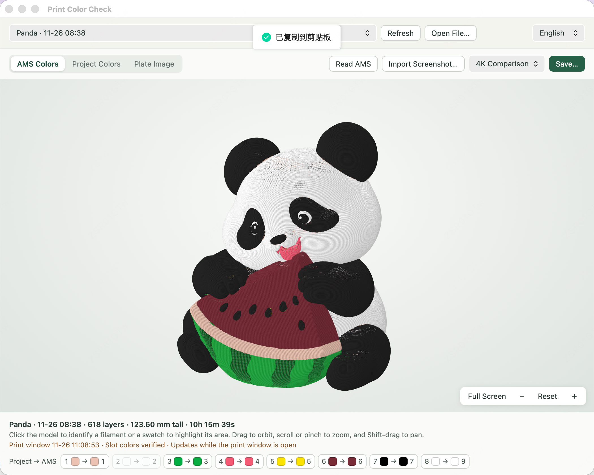
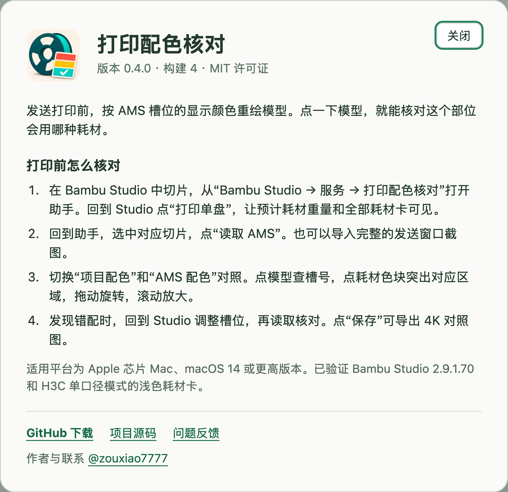

简体中文 | [English](README.en.md)

<p align="center"></p>

# 打印配色核对 · BambuPrintColorCheck

给 Bambu Studio 用的独立 Mac 助手。它读取当前盘的切片路径和发送窗口中的 AMS 耗材卡，以槽位显示色绘制可放大、可旋转的 3D 模型，让你在发送前看清每种耗材会打在哪个部位。

[下载 Mac 测试版](https://github.com/zouxiao7777/BambuPrintColorCheck/releases) · [安装说明](Docs/INSTALL-Chinese.txt) · [问题反馈](https://github.com/zouxiao7777/BambuPrintColorCheck/issues) · [联系作者 @zouxiao7777](https://github.com/zouxiao7777)

## 什么情况下用

例如，你把熊猫的舌头涂成粉色，但在发送窗口里给这款粉色耗材选了装黑料的槽。工程预览里的舌头仍是粉色。切到助手的“AMS 配色”，放大嘴部，就能看到它按当前映射会显示为黑色。如果几种工程色都被映射到同一槽，点击各自的色块即可分别检查它们负责的区域。


<details><summary>查看英文界面截图</summary>



</details>

## 安装与使用

1. 下载 Release 中的 macOS arm64 ZIP，解压并把 `BambuPrintColorCheck.app` 拖入“应用程序”，打开一次。升级前先退出旧版助手。
2. 在 Bambu Studio 中切片，点屏幕顶部的 **Bambu Studio → 服务 → 打印配色核对**。第一次点击会启动助手，再次点击会调回原来的预览窗口。回到 Studio 点“打印单盘”，保持预计耗材克重和全部耗材卡可见，然后在助手顶部选中对应的工程和切片。
3. 点“读取 AMS”。授予 macOS 屏幕录制权限后，助手会读取所选 Studio 进程的发送窗口，窗口打开期间约每四秒复查。也可以导入该窗口的完整截图。截图反映截取时的映射，改槽后需重新读取或导入新图。
4. 切换“项目配色”和“AMS 配色”，在同一视角对照。点模型查耗材与槽号，点色块突出它负责的外表面，再点左上角的耗材标签放大。拖动旋转，滚动或捏合缩放，Shift 拖动平移。
5. 发现错配后回 Studio 改槽，复查后再发送。助手可保存 4K 对照图或单幅槽位配色图。右上角的“关于”和 macOS 应用菜单都能打开用法、版本、下载和联系方式。

菜单名称跟随 macOS 的服务菜单语言。助手界面可在右上角单独切换中英文。如果找不到入口，打开“Bambu Studio → 服务 → 服务设置…”，在“通用”下勾选“打印配色核对”。



## 适用范围

- Apple 芯片 Mac，macOS 14 或更新版本。本次实测环境为 macOS 26.5、Bambu Studio 2.9.1.70 和 H3C 单口径模式的浅色耗材卡。其他卡片布局需另行验证。
- 支持正在运行的 Studio 工程缓存、Bambu 注释格式的 `.gcode` 和已切片的 `.gcode.3mf`。普通 `.3mf` 只有模型或盘面原图时，先在 Studio 中切片才能核对 3D 外观。
- 识别器检查耗材卡顺序、工程色、槽号和可用的预计克重。预览使用槽位在界面中登记的单色和切片外表面路径，实际装料、透明度、渐变和光泽需结合实物判断。
- 这是独立开发的非官方工具。公开测试包使用本地签名，尚未完成 Apple Developer ID 签名与公证。

## 从源码构建

在 Apple 芯片 Mac 上安装 Xcode Command Line Tools，使用支持 ScreenCaptureKit 截图接口的 macOS 14 或更高版本 SDK，运行：

```sh
./build.sh
open BambuPrintColorCheck.app
```

用现有切片和完整发送窗口截图自动导图：

```sh
./BambuPrintColorCheck.app/Contents/MacOS/PlatePreview \
  --project "/path/to/plate.gcode.3mf" \
  --snapshot "/path/to/send-window.png" \
  --export "/path/to/color-check.png"
```

`--highlight 4` 将视角定位至工程耗材 4，`--actual-only` 导出单幅槽位配色图。命令行导出需使用新的目标文件名。`./Scripts/package.sh` 将当前版本打包到 `dist/`。

许可证为 [MIT](LICENSE)。Studio 格式参考见官方的[发送窗口](https://github.com/bambulab/BambuStudio/blob/v02.09.01.70/src/slic3r/GUI/SelectMachine.cpp)、[耗材卡](https://github.com/bambulab/BambuStudio/blob/v02.09.01.70/src/slic3r/GUI/MaterialItemHotend.cpp)和[切片缓存](https://github.com/bambulab/BambuStudio/blob/v02.09.01.70/src/slic3r/GUI/PartPlate.cpp)源码。
